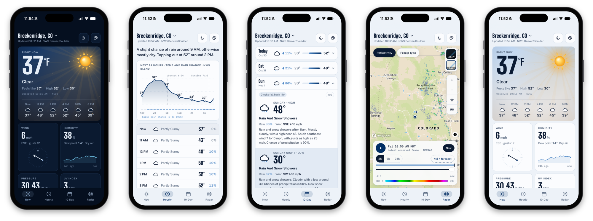

# Fairweather

Personal, ad-free, no-login weather app. Live at **[openglades.com/fairweather](https://openglades.com/fairweather)**.

Fairweather blends official National Weather Service forecasts and station observations with
high-resolution models, adds a full radar loop with an HRRR forecast, and installs on your phone's
home screen as an app with push alerts. Saved places and settings stay in your browser: there are no
accounts and no tracking.

Coverage: all 50 states, Puerto Rico, and the U.S. Virgin Islands (wherever the National Weather
Service forecasts). Elsewhere it falls back to model-only forecasts, without station readings, alerts,
or radar.

<p align="center">
  
</p>

## Features

- **Now:** the nearest NWS station readings (feels like, wind, humidity, pressure trend, visibility),
  UV, sunrise/sunset, air quality, and rain over the past 24 hours, plus NWS alerts.
- **Hourly:** a 24-hour temperature and rain-chance chart and an hourly list, from a weighted blend of
  the NWS forecast with the NBM, HRRR, and ECMWF models.
- **10-Day:** NWS day and night forecasts, word for word, for days 1 to 7, and a three-model mean with
  its spread for days 8 to 10.
- **Radar:** past 2, 6, or 24 hours of radar plus up to 18 hours of HRRR forecast, in reflectivity or
  precipitation type, for the lower 48, Alaska, Hawaii, and Puerto Rico. Forecast frames are clearly
  marked as model output.
- **Push notifications:** NWS alerts for your saved places, "rain soon" in the next hour, and an optional
  morning brief, with quiet hours. No account; the browser's push subscription is its identity.
- **Installable PWA** that works offline with the last forecast, and **eleven Kansas City color themes**
  in light, dark, or auto.

## Run locally

Needs Node 20 to 25 (`.node-version` says 24; better-sqlite3 has no Node 26 build yet).

```sh
npm install
cp env.sample .env.local     # add a Mapbox public token for the Radar page
npm run dev                  # http://localhost:3100/fairweather
npm run typecheck
npm run contrast             # WCAG contrast check for all 22 palettes
```

Everything works without a Mapbox token except the Radar map. Push notifications need VAPID keys
(`npx web-push generate-vapid-keys`); see `env.sample`.

## Deploy

Fairweather runs as a Node service behind nginx at the `/fairweather` path, with a crontab for alerts,
rain-soon notifications, and the radar cache. See **[docs/DEPLOYMENT.md](docs/DEPLOYMENT.md)**.

## Layout

```
app/
  layout.tsx, page.tsx      root layout (fonts, PWA metadata, theme bootstrap), single page
  components/               FairweatherApp shell + Now, Hourly, TenDay, Radar pages, sheets, icons
  lib/                      client: storage wrapper, themes, formatting, push client, basePath
  api/                      forecast, alerts, geocode, radar/manifest, radar/tile, push/*, cron/[job]
lib/                        server: NWS/Open-Meteo fetchers, forecast merge, radar manifest and tile
                            cache, MRMS precip type, SQLite, web push, cron jobs; themes.json; types
lib/workers/                mrms-decode.mjs: MRMS GRIB2 decoding off the main thread
public/                     sw.js (offline + push), manifest.webmanifest, icons/
scripts/                    cron.sh (crontab entry point), contrast.mjs
deploy/                     systemd unit and nginx location block
```

Everything is served under `basePath: '/fairweather'` (`next.config.ts`). `fetch()` calls go through
`app/lib/base.ts` because Next does not prefix those.

## Data

| What | Source | Notes |
|------|--------|-------|
| Now | Nearest NWS stations (up to 4 within 40 km): best of distance and report age, blended with stations within 25 km reporting at about the same time; used when under 3 h old, else Open-Meteo | Blank API fields are filled from the raw METAR. The forecast nudge only uses readings under 80 min old. When a station says "Clear" but the NWS grid shows 60%+ sky cover (high clouds the sensor can't see), the current-hour NWS condition is used |
| Hourly | Blend: NWS hourly 0.55, NBM 0.25, HRRR 0.15 (moves to NBM after h18), ECMWF 0.05; gusts from the NWS grid | NBM/HRRR/ECMWF come from Open-Meteo's `models=`. Observation nudge on temp and dew point for hours 0 to 5. Stale grid (over 6 h) drops NWS weight for hours 1 to 12 |
| Days 1 to 7 | NWS forecast periods, verbatim | |
| Days 8 to 10 | Mean of ECMWF, GFS, ICON (whichever reach that day) with spread | If NWS is down, all 10 days are Model and the UI says so |
| Alerts | NWS `/alerts/active` | |
| AQI | EPA AirNow if `AIRNOW_API_KEY`, else CAMS via Open-Meteo | |
| Radar, observed | IEM NEXRAD N0Q composite archive (5-min mosaics) | Base reflectivity; one national mosaic covering the lower 48, Alaska, Hawaii, and Puerto Rico |
| Radar, observed precip type | NOAA MRMS `PrecipFlag` + `MergedBaseReflectivityQC` from AWS (`noaa-mrms-pds`), lower 48, Alaska, Hawaii | Rendered to tiles by this server (`lib/mrms.ts`; GRIB2 template 5.41 decoded in a worker): rain greens to red, snow blues, rain with hail pink |
| Radar, forecast | IEM HRRR tiles (`REFD`, `REFP` for precip type), pinned to the newest complete run | Lower 48 only; never mixes runs |

Server responses are cached in memory (forecast 10 min, points 24 h, alerts 2 min).

Radar tiles go through `/fairweather/api/radar/tile/...`, which stores each tile on disk (`data/tiles`)
and serves it as immutable. The `radar` cron job pre-fetches the default 2 h loop and the first 6 h of
forecast around Kansas City and subscribers' saved places, and prunes frames older than 25 h and all
but the newest two HRRR runs. The Radar page adds frames to the map a few at a time, Now first.

## Push

Standard Web Push via `web-push` with VAPID keys from `.env.local`. The browser's subscription is its
identity and its `auth` secret is the credential for prefs, unsubscribe, and test sends.
`scripts/cron.sh` calls `POST /fairweather/api/cron/{job}` with `FAIRWEATHER_CRON_SECRET`; nginx
blocks that path from outside.

- **alerts** (every 2 min): new NWS alerts for any saved location's forecast or county zone, at or above
  the user's threshold. The deliveries table dedupes, so a replay never sends twice. Quiet hours hold
  everything except Severe/Extreme warnings; held alerts go out after quiet hours if still active.
- **rain** (every 15 min): "Rain soon" from Open-Meteo `minutely_15` for the primary (first) location,
  3 h cooldown, plus the morning brief once per local day.
- **radar** (every 5 min): radar tile cache prewarm and prune (see Data).
- **cleanup** (daily): 404/410 responses delete a subscription immediately on send; this sweep removes
  dead (10+ failures over 7 days) and abandoned (120 days unseen, no success in 30) subscriptions and
  prunes old rows.

## Design notes and limitations

- Built for one small server: Next.js API routes, SQLite, and a crontab, with no separate radar
  pipeline. Reflectivity comes from IEM tiles; observed precip type is decoded from MRMS GRIB2 on
  demand.
- No Composite or 1-hr rain radar layers (IEM's MRMS 1-hr tiles paint no-data areas opaque gray).
- Observed frames are 10 min apart for 2 h and 6 h, 30 min for 24 h; forecast frames are 30 min apart,
  to keep phone GPU memory reasonable. Change `OBS_STEP_MIN` / `FCST_STEP_MIN` in `lib/radarFrames.ts`.
- HRRR forecast tiles use IEM's color table, which differs slightly from the observed ramp.
- 0 to 2 h rain uses Open-Meteo `minutely_15` rather than a radar nowcast.
- Blend weights are fixed starting values; there is no verification log or tuning yet.
- Three palettes failed the WCAG 4.5:1 check for text on the accent color (Prairie Sky light, Sprout
  Track light, Monarchs dark); their `onAccent` color was changed to a dark ink.

## Credits

Forecasts, observations, and alerts from NOAA / National Weather Service. Model data (NOAA HRRR, NBM,
and GFS, ECMWF IFS, DWD ICON) and air quality (CAMS) via [Open-Meteo](https://open-meteo.com). Radar
from NOAA NEXRAD and HRRR via the [Iowa Environmental Mesonet](https://mesonet.agron.iastate.edu), and
NOAA MRMS from the [NOAA Open Data Dissemination](https://registry.opendata.aws/noaa-mrms-pds/) program
on AWS. Air quality from EPA AirNow when configured. Basemaps by [Mapbox](https://www.mapbox.com) and
OpenStreetMap contributors.

Model forecasts are guidance, not observations. For life-safety decisions, follow official NWS warnings.

## License

[MIT](LICENSE) © 2026 John Overton
